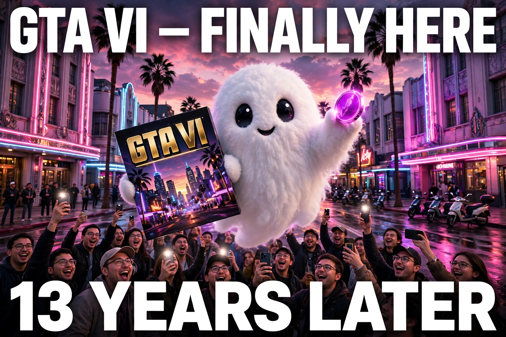

# GTA 6 Meme — Ghost Mengantar GTA VI

[](https://make.fun/bounty/gta6-meme-x-01)
[](https://make.fun/bounty/gta6-meme-x-01)
[](https://make.fun/bounty/gta6-meme-x-01)

Entry for the [make.fun bounty "Post a GTA 6 meme on X"](https://make.fun/bounty/gta6-meme-x-01) — $500, top 50.

## The meme



After 13 years of waiting, the big fluffy make.fun ghost finally flies down a
neon Vice City street at dusk, carrying a glowing GTA VI game box and a magenta
coin, while a crowd of gamers cheers below. **GTA VI — FINALLY HERE.**
**13 YEARS LATER.**

## How this entry works

The program does not post to X. It only copies `POST.json` — which holds the
URL of the meme post published by [@Aairdropp_Id](https://x.com/Aairdropp_Id)
on X — into the output directory, byte-for-byte.

```sh
node main.ts
```

## Files

| File | What it is |
| --- | --- |
| `meme.png` | The meme image (1920×1280) |
| `main.ts` | Copies `POST.json` to the output directory |
| `POST.json` | URL of the X post (placeholder until the user posts) |
| `CAPTION.txt` | Caption for the X post, including the bounty link, @makefunai and the play code |
